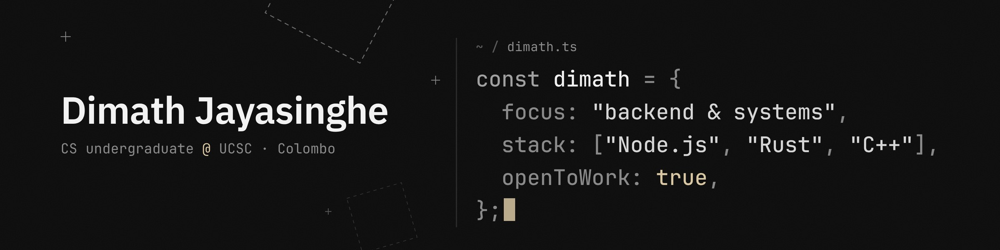

Computer Science undergraduate at the University of Colombo School of Computing (UCSC), graduating April 2027.

I build backend services, network servers and real-time systems, and I like going down to the protocol level to understand how things work. **Open to remote software engineering internships and graduate roles.**

[Email](mailto:dimathjayasinghe@gmail.com) · [LinkedIn](https://www.linkedin.com/in/dimath-jayasinghe/) · [HackerRank](https://www.hackerrank.com/profile/Dimath_Jaya)

## Projects

> **[wsrv](https://github.com/DimathJayasinghe/wsrv)** &nbsp;`C++23` `Linux` `TLS` `Docker` `Prometheus` 
> WebSocket server written from scratch in C++23 (RFC 6455), with no Boost, Asio or WebSocket library. TLS, compression, rooms and pub/sub, PHP and JavaScript clients, multi-arch Docker images. **Passes all 517 Autobahn|Testsuite cases** and runs clean under ASan, UBSan and TSan. [Try the chat demo](https://github.com/DimathJayasinghe/wsrv-chat-demo).

> **[Serendeva](https://github.com/Serendeva)** &nbsp;`NestJS` `PostgreSQL` `Prisma` `Redis` `BullMQ` `Socket.IO` 
> AI wardrobe and fashion platform, in development by a team of five. I lead the repository and releases and work on the backend: the outfit-suggestion API that sends jobs to a Python AI worker, the real-time notification gateway, rate limiting and idempotent requests. **Top contributor** in the private team repository.

> **[poker-credits](https://github.com/DimathJayasinghe/poker-credits)** &nbsp;`Rust` `tokio` `axum` `Flutter` 
> Replaces chips at an in-person poker table. A deterministic Rust game engine and a tokio WebSocket server run inside the app, so players join over local Wi-Fi with no internet. **Published on the Microsoft Store.**

> **[Academic LMS](https://github.com/DimathJayasinghe/LMS)** &nbsp;`Node.js` `Express` `PostgreSQL` `Redis` `BullMQ` `Next.js` 
> Learning management system for a tuition institute with about 1,200 students, in development. Role-based access, online exams, PayHere payments and protected video, running on a single VPS with Docker Compose.

> **[GRADLINK](https://github.com/DimathJayasinghe/GRADLINK)** &nbsp;`PHP` `MySQL` 
> UCSC alumni network built from scratch in PHP and MySQL with custom routing and sessions and no frameworks. 2nd-year group project of four, **led by me**.

## Recognition

- HackerRank Gold badge in Problem Solving, 5-star in C++
- IEEE Xtreme: team ranked in the global top 600
- Model X (IIT IEEE Student Branch): led the team that placed 1st in Round 1
- Dean's List, Semester 2, UCSC

## Tech stack

<table>
<tr>
<td><b>Systems</b></td>
<td>
 &nbsp;
 &nbsp;
<picture><source media="(prefers-color-scheme: dark)" srcset="images/tech/rust-dark.svg"></picture> &nbsp;

</td>
</tr>
<tr>
<td><b>Backend</b></td>
<td>
 &nbsp;
 &nbsp;
 &nbsp;
<picture><source media="(prefers-color-scheme: dark)" srcset="images/tech/express-dark.svg"></picture> &nbsp;
 &nbsp;

</td>
</tr>
<tr>
<td><b>Data &amp; infra</b></td>
<td>
 &nbsp;
 &nbsp;
 &nbsp;
 &nbsp;

</td>
</tr>
<tr>
<td><b>Web &amp; mobile</b></td>
<td>
 &nbsp;
<picture><source media="(prefers-color-scheme: dark)" srcset="images/tech/nextdotjs-dark.svg"></picture> &nbsp;
 &nbsp;
<picture><source media="(prefers-color-scheme: dark)" srcset="images/tech/expo-dark.svg"></picture> &nbsp;

</td>
</tr>
</table>
