<picture>
  <source media="(prefers-color-scheme: dark)" srcset="assets/dark/hero.svg">
  
</picture>

### Dimath Jayasinghe · Backend & Systems Engineer

I build backend services and low-level systems: network servers, real-time messaging, APIs and the infrastructure under them. I'm most at home in **C, C++ and Rust**, and I ship full-stack products in **TypeScript** when the job needs it. I'm a Computer Science undergraduate at the **University of Colombo School of Computing (UCSC)**, currently **looking for a software engineering internship** in backend, systems or full-stack.

| | |
| :--- | :--- |
| **Looking for** | Software Engineering Internship · Backend · Systems / Infrastructure · Full-Stack |
| **Strengths** | System design · networking & WebSockets · concurrency · API design · real-time systems · testing & fuzzing |
| **Languages** | C · C++ · Rust · TypeScript · JavaScript · Python · Java · C# · PHP · Dart |
| **Backend & data** | Node.js · NestJS · Express · Spring · Flask · PostgreSQL · MySQL · MongoDB · Redis · Prisma · BullMQ |
| **Infra** | Docker · Nginx · Linux · Kubernetes · Cloudflare · GitHub Actions · Vercel |
| **Education** | Computer Science undergraduate, UCSC, University of Colombo |
| **Location** | Sri Lanka (UTC+5:30) |
| **Contact** | [dimathjayasinghe@gmail.com](mailto:dimathjayasinghe@gmail.com) · [LinkedIn](https://www.linkedin.com/in/dimath-jayasinghe/) |

 

<picture>
  <source media="(prefers-color-scheme: dark)" srcset="assets/dark/sec-systems.svg">
  
</picture>

<a href="https://github.com/DimathJayasinghe/wsrv"><picture><source media="(prefers-color-scheme: dark)" srcset="assets/dark/p-wsrv.svg"></picture></a>

<a href="https://github.com/Serendeva"><picture><source media="(prefers-color-scheme: dark)" srcset="assets/dark/p-serendeva.svg"></picture></a>

<a href="https://github.com/DimathJayasinghe/poker-credits"><picture><source media="(prefers-color-scheme: dark)" srcset="assets/dark/p-poker.svg"></picture></a>

<a href="https://github.com/DimathJayasinghe/LMS"><picture><source media="(prefers-color-scheme: dark)" srcset="assets/dark/p-lms.svg"></picture></a>

<a href="https://github.com/DimathJayasinghe/GRADLINK"><picture><source media="(prefers-color-scheme: dark)" srcset="assets/dark/p-gradlink.svg"></picture></a>

<b>Plain-text project summary</b>

- **[wsrv](https://github.com/DimathJayasinghe/wsrv)** (C++23, open source): RFC 6455 WebSocket server written from scratch, with no Boost or Asio. It has a sans-I/O protocol core, epoll event loops, TLS, permessage-deflate, pub/sub and Prometheus metrics. Other languages reach it through a stable C ABI, and PHP gets bindings via FFI and the `wsrvd` sidecar. It passes all 517 Autobahn testsuite cases and is tested with fuzzing and ASan, UBSan and TSan.
- **[Serendeva](https://github.com/Serendeva)** (TypeScript, private org repo): AI-powered wardrobe and fashion intelligence platform. A pnpm and Turborepo monorepo with a NestJS API, a Next.js B2B portal, an Expo mobile app, PostgreSQL with Prisma, and Redis, plus a separate Python AI worker. I'm the top contributor.
- **[poker-credits](https://github.com/DimathJayasinghe/poker-credits)** (Dart, Rust): digital chips and side pots for in-person Texas Hold'em. The table device runs a LAN game server, so no internet is needed. A Rust engine handles rules, pots and computer players. Published on the Microsoft Store.
- **[LMS](https://github.com/DimathJayasinghe/LMS)** (TypeScript): learning management system for a tuition institute with about 1,200 students and five roles. Next.js, Express, PostgreSQL, Redis and BullMQ, deployed on one VPS with Docker Compose. Results publish over SSE, payments are idempotent, and it is multi-tenant ready.
- **[GRADLINK](https://github.com/DimathJayasinghe/GRADLINK)** (PHP, MySQL): UCSC alumni and student networking platform with role-based access, groups, mentoring and messaging. Built from scratch without frameworks by a team of four. I'm the top contributor.

 

<picture>
  <source media="(prefers-color-scheme: dark)" srcset="assets/dark/sec-stack.svg">
  
</picture>

<picture>
  <source media="(prefers-color-scheme: dark)" srcset="assets/dark/stack.svg">
  
</picture>

 

<picture>
  <source media="(prefers-color-scheme: dark)" srcset="assets/dark/sec-lab.svg">
  
</picture>

| repo | what it is | lang |
| :--- | :--- | :--- |
| [`wsrv-chat-demo`](https://github.com/DimathJayasinghe/wsrv-chat-demo) | chat app with accounts and live messages, running on wsrv | PHP |
| [`WebSocket-Implementation`](https://github.com/DimathJayasinghe/WebSocket-Implementation) | WebSockets built up from the protocol, including fragmented frames | JS |
| [`WebSocket-server-from-scratch`](https://github.com/DimathJayasinghe/WebSocket-server-from-scratch) | my first hand-rolled WebSocket server, where wsrv started | JS |
| [`Client-server-pub-sub`](https://github.com/DimathJayasinghe/Client-server-pub-sub) | client/server publish-subscribe messaging | Python |
| [`my_Physics_Engine1`](https://github.com/DimathJayasinghe/my_Physics_Engine1) | tiny physics engine for projectile trajectories | C |
| [`FloodFill-Algorithm`](https://github.com/DimathJayasinghe/FloodFill-Algorithm) | flood fill, implemented and visualised | C++ |
| [`Freshers`](https://github.com/DimathJayasinghe/Freshers) | live-updating scoreboard for the UCSC Freshers' meet | TS |

 

<picture>
  <source media="(prefers-color-scheme: dark)" srcset="assets/dark/sec-stats.svg">
  
</picture>

  <picture>
    <source media="(prefers-color-scheme: dark)" srcset="https://github-readme-stats.vercel.app/api?username=DimathJayasinghe&show_icons=true&hide_border=false&bg_color=10161D&border_color=30363D&title_color=E6EDF3&icon_color=4C8DFF&text_color=8B949E&border_radius=14">
    
  </picture>
  <picture>
    <source media="(prefers-color-scheme: dark)" srcset="https://github-readme-stats.vercel.app/api/top-langs/?username=DimathJayasinghe&layout=compact&langs_count=8&bg_color=10161D&border_color=30363D&title_color=E6EDF3&text_color=8B949E&border_radius=14">
    
  </picture>

 

<picture>
  <source media="(prefers-color-scheme: dark)" srcset="assets/dark/sec-contact.svg">
  
</picture>

  
  

<picture>
  <source media="(prefers-color-scheme: dark)" srcset="assets/dark/footer.svg">
  
</picture>
